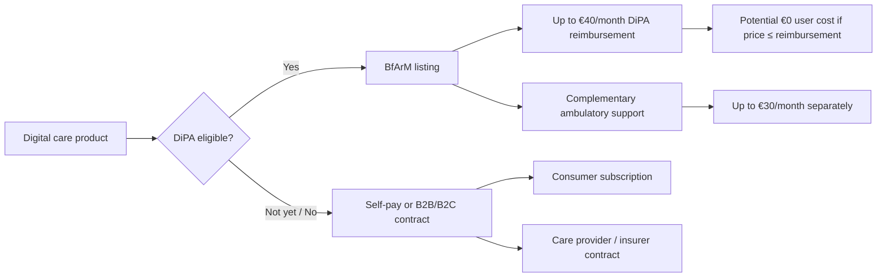
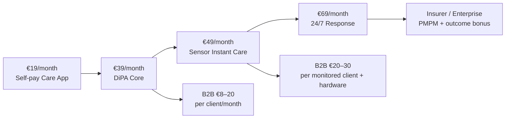

# Pricing of Instant Care, AI-Enabled Elderly Care, and DiPA-Like Digital Care Applications
Executive summary
Germany's elderly-care technology market is splitting into three economically distinct layers: low-cost digital applications, consumer safety and emergency-response services, and institutional AI/sensor platforms. Public pricing shows that these layers have very different willingness-to-pay ceilings. A software-only consumer application can sit comfortably around €10–20 per month; a connected monitoring product with dedicated hardware commonly moves into the €25–45 per month range; and services involving a professional 24/7 response centre, in-person response, or extensive sensor infrastructure can reach approximately €40–65+ per month, before institutional customization. Public German examples include LINDERA at €10.42–11.66 per month for recurring home mobility analysis, VmedD at €12.95 per sensor per month plus €239 for the first sensor, libify at €32.13–44.68 per month depending on service level, and Malteser packages ranging from €27 to €64.90 per month. citeturn120382view1turn404543search5turn798364search21turn538534search0
The German DiPA framework now creates a particularly important price anchor. Under §40b SGB XI, an eligible person can receive reimbursement of up to €40 per calendar month for one or more DiPA, while up to €30 per month is separately available for necessary complementary support delivered by an ambulatory care provider. Costs beyond those limits remain the user's responsibility. The current BMG guidance reflects this €40 + €30 structure. citeturn130531search0turn130531search1 The reform is strategically significant because the DiPA definition was broadened from July 2026 to include applications supporting informal caregivers when they stabilize home care or relieve caregiver burden, while the BfArM process now allows provisional listing for up to one year. citeturn677864search2turn677864search3
For a new German home-care product, the most defensible pricing architecture is therefore not one universal subscription. A software-only DiPA should be designed around the statutory ceiling, preferably €29–39 per month. An Instant Care tier with sensors and caregiver escalation can reasonably target €39–59 per month, with hardware either sold separately for approximately €99–299 or amortized into a 12–24 month subscription. A premium tier involving a staffed monitoring centre should be positioned around €59–79 per month, because public German benchmarks already approach €65 where human response is included. These are recommended launch benchmarks derived from the observed market, rather than statutory or quoted competitor prices. citeturn404543search5turn538534search0turn798364search14turn798364search15
For B2B sales, the transparent market is thinner. Public German software benchmarks range from about €2.50–12.95 per resident per month for conventional care software, while sensor and AI systems are commonly quote-based. CareCloud publishes €12.95 per resident place per month; Komda lists cloud pricing from €3.50 per resident per month; broader organization-level solutions commonly charge hundreds of euros per facility per month plus implementation. CareSocial, for example, lists €199–399 per month plus a €999 initial setup fee and a two-year initial contract. citeturn404543search0turn404543search1turn404543search9 For a differentiated AI care platform, a viable benchmark is therefore roughly €8–25 per monitored resident per month for software, with sensor hardware, integrations and implementation quoted separately.
The larger strategic context is consistent with the Silver Society framing supplied by Agentur Junges Herz. Its article describes the Silver Society as a structural global megatrend and emphasizes that people over 60 should increasingly be understood as active participants seeking autonomy, flexibility, mobility and continued social participation rather than as a homogeneous passive-retirement segment. citeturn896211view0 That framing matters for pricing: elderly-care technology should increasingly be sold around independence, reassurance and control, with care escalation in the background, rather than purely around frailty. This reinforces the broader conclusion of the earlier Silver Society research that value in Instant Care comes from shortening the distance between a meaningful signal and an effective response. fileciteturn0file0
Consumer market pricing in Germany and Europe
The most mature consumer reference category is the German Hausnotruf/PERS market. It provides the best observable pricing benchmark because hardware, connectivity, call-centre capacity and reimbursement are already bundled into recurring fees.
Product / category
Device or setup
Recurring price
Human monitoring
Typical contract characteristic
libifyBasic
included
€32.13/month
Yes
may fall to €0 after approved Pflegekasse coverage
libifyHome with fall detection
included
€41.68/month
Yes
€9.55 user share after cited subsidy
libifyMobil 2.0
included
€44.68/month
Yes
€12.55 user share after cited subsidy
Patronus Light
device included in service
€30.30/month without Pflegegrad
Yes
classic home emergency service
Patronus watch, selected tariff
€20–89 device charge depending on plan
from effective €2–10/month after approved reimbursement on displayed plans
varies by tariff
monthly, 12-month and 24-month plans
easierLife HOME
€49.90 provisioning
€29.95/month
Yes
test month offered
easierLife HOME Family
€49.90 provisioning
€19.95/month
Family response
family rather than monitoring-centre escalation
easierLife HOME&GO
€49.90 provisioning
€44.95/month
Yes
mobile monitoring
Malteser Grundsicherheit
€0 currently shown
€27/month
Yes
monitoring centre; eligible customers can receive reimbursement
Malteser Komplettsicherheit
€0 currently shown
€60.40/month
Yes + local response
device rental and maintenance included
Malteser Komplettsicherheit Plus
€0 currently shown
€64.90/month
Yes + local response + activity sensing
device rental and maintenance included
VmedD Care Monitor
€239 first sensor; €219 additional sensor
€12.95/sensor/month
automated family/user alerts rather than equivalent full PERS response centre
annual or half-year prepayment discounts
LINDERA L.Home
no dedicated hardware
€13.99 once; €11.66/month six-month plan; €10.42/month long-term plan
No
smartphone app
ElliQ
US$249 initiation
US$39–59/month
AI companion, not emergency centre
lower monthly rate requires longer commitment

Sources: libify publishes regular monthly prices of €32.13, €41.68 and €44.68, with approved Pflegekasse support reducing the latter two examples to €9.55 and €12.55 user contributions. citeturn798364search8turn798364search14turn798364search15 Patronus publishes monthly, 12-month and 24-month structures and shows examples combining a one-time €20 or €89 device payment with low residual subscription charges after reimbursement. citeturn120382view0 easierLife publishes €19.95 for the family version and €29.95 for monitoring-centre HOME, both with a €49.90 provisioning charge; its HOME&GO pricing page lists €44.95. citeturn120382view3turn538534search2 Malteser currently lists €27, €60.40 and €64.90 packages and explicitly includes installation, maintenance and device service within the relevant packages. citeturn538534search0turn538534search1
The VmedD model illustrates the economics of ambient monitoring without a full call-centre layer. Its first sensor costs €239, each additional sensor €219, and each sensor requires a €12.95 monthly service fee. Annual payment lowers the effective recurring cost. citeturn404543search4turn845058search7 This creates a materially different cost structure from PERS: the customer pays more hardware upfront but less monthly because there is less ongoing human-response infrastructure.
LINDERA provides an even clearer software reference. Its L.Home page currently lists a single analysis at €13.99, a six-month package at €11.66 per month, and an unlimited plan at €10.42 per month with monthly cancellation after the first 12 months. citeturn120382view1 That suggests a natural €10–15/month floor for specialized clinically oriented digital care software sold directly to consumers before reimbursement.
ElliQ demonstrates a different model: hardware is effectively leased as part of a recurring AI-companion relationship. The current public membership page shows US59/monthonamonthlyplan,US49/month billed annually and US$39/month on a 24-month plan. citeturn845058search5 This makes ElliQ commercially more comparable to a bundled connectivity/service product than to a one-off consumer robot.
A useful market-pricing ladder is therefore:
Consumer offer
Observed / defensible monthly range
Main cost element
App-only mobility, reminders, caregiver support
~€10–20
software, support, compliance
Passive sensor monitoring without staffed response
~€13–30 plus hardware
sensors, cloud, alerts
Family-response emergency system
~€20–35
connectivity, device amortization
Professional PERS / mobile emergency response
~€30–45
24/7 monitoring centre
PERS plus local response / advanced sensors
~€55–65+
monitoring plus human intervention
AI companion device
~€35–60 equivalent
hardware lease, AI service, cloud

These bands are synthesized from the public examples above and should be treated as pricing benchmarks rather than formal market averages. citeturn404543search5turn538534search0turn120382view3turn845058search5
Institutional and B2B pricing
Institutional elderly-care technology is much less transparent because procurement is usually negotiated according to facility size, sensor count, integrations, implementation effort and service level. Several relevant vendors do not publish institutional pricing at all.
The observable German software market nevertheless provides useful anchors. CareCloud's entry subscription is €12.95 per resident place per month, billed annually. citeturn404543search0 Komda advertises cloud care-documentation pricing from €3.50 per resident per month, while its rental model begins at €2.50. citeturn404543search1 MCD publishes facility-level pricing of €150 per month for ambulatory organizations and €250 per month for stationary facilities for its Komfort package, which combines documentation, networking and sensor interfaces. citeturn404543search3
CareSocial illustrates the integration/implementation component. Its software is listed at €199–399 per month, with a one-time €999 setup fee. Its standard public terms specify a two-year initial term, automatically extending by one year unless cancelled three months before expiry. citeturn404543search9 DMRZ provides another structure: a €179.99 monthly premium plan with a 12-month minimum contract and transaction-based billing beyond an included billing volume. citeturn404543search10
For sensor-heavy institutional systems, hardware moves the economics higher. A European reseller currently lists the Nobi smart fall-detection lamp at €1,299 excluding VAT, showing how room-based sensing can require four-figure capital expenditure even before service and integration. citeturn404543search6 Another European fall-detection supplier, Healthcall, describes typical hardware as running from a few hundred euros upward per equipped room, with software licensing and installation separate. citeturn404543search8
This supports the following B2B benchmark architecture:
Component
Market evidence / recommended benchmark
Generic care SaaS
~€2.50–13 per resident/month observed
Specialized AI care software
€8–25 per monitored resident/month recommended
Advanced analytics + workflow integration
€20–40 per resident/month recommended where measurable labor/risk savings exist
Sensor hardware
~€200 to >€1,500 per room/resident depending on architecture
Facility SaaS minimum
~€150–400/month observed for some German care platforms
Initial setup
€0 to ~€1,000 for simpler software; materially higher for enterprise integrations
API/EHR/documentation integration
usually quote-based
Enterprise deployment
typically negotiated by site, bed count and integration complexity

The recommended AI ranges are inferences from the public care-software floor, the consumer sensor market and the capital cost of institutional sensing. They should therefore be validated through procurement interviews rather than represented as published competitor tariffs. citeturn404543search0turn404543search3turn404543search6
A viable enterprise contract can separate four charges: implementation, hardware, platform subscription, and premium response/integration services. This avoids forcing a high sensor cost into the SaaS sticker price and makes ROI easier for a care operator to evaluate.
DiPA reimbursement and the effective user price
The DiPA reimbursement architecture changed materially in 2026. The current §40b SGB XI states that when a Pflegekasse approves one or more DiPA, the insured person is entitled to reimbursement of expenses for those applications up to €40 per calendar month. Separately, complementary support delivered by ambulatory care providers can be reimbursed up to €30 per month. citeturn130531search1turn130531search2
The BMG confirms that any DiPA expenditure above €40 remains the patient's responsibility and that additional support above €30 likewise becomes an out-of-pocket cost. citeturn130531search0turn130531search8
That produces a simple end-user pricing equation:
Net monthly user cost = DiPA list/reimbursement price − up to €40 approved reimbursement + any uncovered complementary-service cost above €30.
Examples:
DiPA price
Approved DiPA reimbursement
End-user DiPA cost
€19/month
€19
€0
€29/month
€29
€0
€39/month
€39
€0
€40/month
€40
€0
€49/month
€40
€9
€59/month
€40
€19

This table assumes the product qualifies, is listed, the individual claim is approved and no other DiPA consumes part of the monthly €40 ceiling. The statutory wording applies the €40 total to one or more applications combined rather than granting €40 per product. citeturn130531search1
The commercial implication is powerful: €39–40 is a psychologically and economically important ceiling for a DiPA-first product. Pricing a reimbursable app at €49 creates a €9 monthly user contribution; moving from €39 to €49 therefore changes the product from potentially zero-out-of-pocket to a consumer co-pay product.
The separate €30 support allowance means onboarding can be structured differently. A DiPA company could keep the digital product at or below €40 and use an ambulatory partner for eligible human support, onboarding or care-process assistance funded separately where permitted. The BMG explicitly describes the support allowance as available when complementary assistance is necessary for use of the DiPA. citeturn130531search0
The reimbursement route remains commercially immature. BfArM's current DiPA API documentation still states that the current production version is not providing data. citeturn677864search0 In parallel, BfArM's July 2026 update explains that the rules now permit provisional listing for up to one year and broaden the definition to applications supporting informal caregivers. citeturn677864search2 The practical implication is that a startup should treat DiPA as a strategic reimbursement route while maintaining a B2C/B2B commercialization path that can operate before or alongside listing.

Vendor-specific pricing and business models
Vendor
Market
Public pricing found
Model / interpretation
CarePredict
wearables + predictive elder monitoring
Consumer reseller lists US$69/month; institutional price no public vendor price found
subscription plus hardware; enterprise quote
SafelyYou
AI vision/fall detection for senior living
No public price found
B2B enterprise contract
ElliQ
AI companion
US39/month24-month,US49/month annual, US59/monthmonthly;initiation/hardwareleasefeearoundUS249
leased hardware + subscription
VmedD
German ambient fall/activity monitoring
€239 first sensor, €219 subsequent; €12.95/sensor/month
hardware purchase + recurring monitoring service
Patronus
German emergency watch/PERS
public tariff examples from €10/month plus €89 device, or lower effective residual prices with longer contracts/reimbursement
hardware charge + subscription/term contract
libify
German PERS
€32.13 Basic; €41.68 Home; €44.68 Mobile
bundled device + 24/7 service subscription
LINDERA
German AI fall-risk/mobility analysis
B2C €13.99 single; €11.66/month six-month; €10.42/month long-term; B2B no public price
consumer app subscription; B2B per-user quote
voize
AI speech documentation for care
No public price found
B2B SaaS / enterprise
AssistMe
sensor-based incontinence and movement monitoring
No public price found
B2B sensor + platform solution
easierLife
German PERS
HOME Family €19.95; HOME monitoring centre €29.95; HOME&GO €44.95; €49.90 provisioning on cited offers
service subscription + setup
Malteser
German PERS / response
€27–64.90/month
bundled rental, service, maintenance and human response
CareCloud
German institutional care SaaS
€12.95/resident place/month
per-bed SaaS
CareSocial
German institutional care software
€199–399/month + €999 setup
facility SaaS + implementation

CarePredict's own enterprise pricing is not publicly disclosed; the clearest current consumer reference found was a Canadian reseller publishing US$69 monthly for a single-person subscription. Because this is a reseller rather than CarePredict's own German/EU tariff, it is best treated as a directional benchmark only. citeturn845058search18turn845058search21
SafelyYou remains enterprise-sales-led, and no public tariff was found in the research. Public information supports a hardware + AI software + service architecture, but a numeric per-bed price could not be verified from the vendor. citeturn845058search22
LINDERA is unusually useful because it publishes consumer prices while keeping professional pricing volume-dependent. Its FAQ explicitly states that professional monthly prices depend on the number of seniors or patients. citeturn120382view2
AssistMe describes its alea system as a sensor clip and charger deployed per resident, connected to a digital platform, but the company does not publish a tariff on the reviewed product pages. citeturn538534search28turn538534search24
For voize, the reviewed public materials document the speech-based nursing documentation workflow and integrations, but no public list price was identified. citeturn798364search36turn798364search38
The pricing structure across these vendors can be summarized as four models:
Pricing model
Best fit
Advantages
Main risk
One-time purchase
sensors and simple hardware
simple ownership
upfront barrier; weak recurring revenue
Hardware lease + subscription
companion robots, watches, PERS
lower upfront burden; hardware replacement manageable
longer commitment required to recover hardware
Per-user/per-bed SaaS
care homes, ambulatory providers
scales predictably with customer value
churn when beds/users change
Outcome/shared-savings contract
insurers, large operators
aligns price with avoided cost
requires credible baseline and outcome measurement

The public market also shows that 12–24 month terms are common where hardware is subsidized or leased. ElliQ discounts a 24-month commitment versus monthly billing, Patronus provides monthly/12-/24-month options, while CareSocial specifies a two-year enterprise contract. citeturn845058search5turn120382view0turn404543search9
Cost drivers and pricing sensitivity
The largest mistake in pricing Instant Care is treating the application itself as the main cost centre. The economics change dramatically according to how much physical and human infrastructure sits behind it.
Hardware intensity determines upfront capital requirements. A smartphone-only product such as LINDERA has essentially no dedicated device cost to recover, whereas VmedD requires €239 for the first sensor and Nobi hardware is listed by a reseller at more than €1,500 including VAT. citeturn120382view1turn404543search5turn404543search6
Monitoring-centre labor raises recurring cost. German PERS packages with purely basic response cluster around €27–45 per month, while Malteser's packages with local response, keyholding and enhanced monitoring rise to roughly €60–65. citeturn538534search0turn798364search15 The price premium therefore reflects operational capacity as much as technology.
False alarms and escalation volume are a direct unit-economics variable. An ambient AI system generating twice as many manual review events can require substantially more staffing even when the software cost is unchanged. Pricing models should therefore track alerts per person, percentage requiring human review, average handling time and escalation rate.
Installation and customer success matter especially in older populations. easierLife explicitly charges €49.90 provisioning on cited products, while institutional care software such as CareSocial can charge €999 for initial configuration. citeturn120382view3turn404543search9 For home-care products, remote self-installation can therefore be a meaningful gross-margin lever.
AI inference itself is usually a smaller driver than human workflow for simple prediction or language features. The more expensive requirements are secure infrastructure, monitoring, customer support, device fleet management, auditability, clinical validation and integration into care workflows.
Integration costs rise in B2B deployments because alerts must enter documentation, nurse-call, EHR or care-management environments. MCD explicitly markets sensor and telematics interfaces as part of its care platform, while LINDERA emphasizes integration into documentation systems. citeturn404543search3turn798364search11
Regulatory compliance creates a fixed-cost burden. For DiPA, the commercial model must absorb quality, security, evidence and BfArM process costs; these are difficult to monetize per user until sufficient scale is reached. This is one reason the €40 reimbursement ceiling should influence product scope: a hardware-heavy product may struggle if all hardware and human-service costs must be financed from the DiPA reimbursement alone.
A simplified sensitivity model for a home-care product can therefore be expressed as:
Contribution margin per user = subscription revenue − hardware amortization − connectivity − cloud/AI − monitoring labour − support − payment/distribution costs.
At €39/month, a software-only DiPA can tolerate substantially higher compliance and R&D amortization than a service involving a €250 sensor, cellular connectivity and 24/7 human triage unless those costs are separately financed.
Recommended pricing architecture for a new German DiPA / Instant Care product
The Silver Society article is strategically relevant here because it depicts older adults as a heterogeneous, active population whose needs increasingly include autonomy, mobility, flexibility and continued participation. citeturn896211view0 A new product should therefore avoid a single "frailty" proposition. Pricing should let the customer enter through independence and prevention, then add safety and professional response as risk increases.
Consumer tiers
Tier
Recommended price
Included scope
Strategic rationale
Care App
€19/month
reminders, routines, caregiver coordination, basic AI companion/support
affordable self-pay entry; below DiPA ceiling
DiPA Core
€39/month
personalized care plans, risk monitoring, caregiver portal, clinically validated intervention modules
sits immediately below €40 reimbursement ceiling
Instant Care
€49/month + €149–249 hardware
sensors, automatic event detection, family alerts, escalation workflow
comparable to advanced PERS/mobile monitoring
Instant Care Plus
€69/month, hardware included or leased
sensors + 24/7 professional response + family app
aligns with high-service PERS economics
Family Add-on
€5–9/month per additional caregiver bundle, preferably capped
extra caregiver workflows, reporting and notifications
monetizes network value without burdening core user

The €39 DiPA Core tier is the strongest starting point for reimbursement strategy. It leaves only €1 below the statutory ceiling, while potentially producing zero out-of-pocket cost once approved and reimbursed. The product should avoid requiring expensive dedicated hardware inside that tariff unless hardware economics have a separate reimbursement or leasing route. citeturn130531search0turn130531search1
For self-pay customers, €19 creates a softer adoption point roughly between low-cost digital mobility tools such as LINDERA and family-response PERS services such as easierLife HOME Family. citeturn120382view1turn120382view3
The €49 Instant Care tier is appropriate when sensors create automatic monitoring but professional humans are not continuously in the loop. VmedD demonstrates that sensor monitoring itself can be economically delivered far below €49, leaving room for device amortization, AI analytics, caregiver workflows and service support. citeturn404543search5
The €69 tier is appropriate only when there is real operational service behind the price. Malteser's €60.40–64.90 packages demonstrate that German consumers already encounter pricing at this level for bundled 24/7 safety, local response and sensor-based functions. citeturn538534search0
B2B tiers
For ambulatory care providers and senior-living operators, the pricing should shift away from consumer bundles:
B2B tier
Recommended benchmark
Contract
Software / workflow only
€8–12 per active client/month
12 months
AI risk monitoring
€15–20 per monitored client/month
12–24 months
Sensor + analytics
€20–30 per monitored client/month + hardware
24 months
Enterprise / insurer
€12–25 PMPM at scale, volume-discounted
24–36 months
Implementation
€1,500–10,000 per organization, depending on integration
one-time
API / care-software integration
project fee or €250–1,000/month enterprise connector
annual
Outcome bonus
5–15% variable uplift tied to agreed KPIs
optional

These recommended prices sit above conventional care documentation software because the proposed product would generate continuous care intelligence rather than simply digitize records, while remaining below the economics of adding substantial human labor. Public German care SaaS at €2.50–12.95 per resident provides the lower bound. citeturn404543search0turn404543search1
For pilots, a useful structure is €0–5,000 implementation + €15–25 per monitored person per month for 6–12 months, with the implementation fee credited against rollout if predefined KPIs are achieved. This reduces procurement friction while preventing pilots from becoming permanently free.
For insurers and Pflegekassen, the most compelling long-term contract is likely a PMPM base fee plus an outcome component. The variable portion could be tied to metrics such as fewer ambulance activations, shorter response times, fewer serious fall consequences, fewer avoidable admissions, increased days at home or measurable reductions in care-staff workload. This builds directly on the earlier Instant Care finding that the economic value lies in converting signals into timely interventions rather than in sensing alone. fileciteturn0file0
The resulting pricing ladder can be visualized as follows:

The most defensible launch strategy is therefore software first at €39/month for the reimbursable DiPA layer, optional sensor hardware around €149–249, and a separate €69 professional-response package. It aligns statutory reimbursement, observed German consumer willingness to pay, the economics of PERS, and the operational reality that human response is the component that most sharply increases recurring cost. citeturn130531search0turn404543search5turn538534search0
Key primary-source URLs used in the analysis include the BMG DiPA guidance at https://www.bundesgesundheitsministerium.de/themen/pflege/online-ratgeber-pflege/leistungen-im-ueberblick/digitale-pflegeanwendungen, §40b SGB XI at https://www.gesetze-im-internet.de/sgb_11/__40b.html, the BfArM DiPA documentation at https://fhir.bfarm.de/guide/dipa-overview-de.html, the supplied Silver Society page at https://www.agentur-jungesherz.de/hr-glossar/silver-society/, VmedD pricing at https://vmedd.de/preise-und-pakete/, Patronus pricing at https://www.patronus-uhr.de/preise, libify pricing at https://www.libify.com/notrufsysteme, LINDERA's home offering at https://lindera.de/de/l.home, Malteser pricing at https://www.malteser.de/hausnotruf/kosten.html, and ElliQ membership pricing at https://elliq.com/products/membership. citeturn130531search0turn130531search1turn677864search0turn896211view0turn404543search5turn120382view0turn798364search9turn120382view1turn538534search0turn845058search5Silver Society, Instant Care, and AI-Enabled Elderly Care
Executive Summary
Population ageing presents healthcare and long-term care systems with a challenge of capacity and coordination, rather than simply increasing demand. The number of older people is growing, particularly among the oldest age groups, where care dependency, multimorbidity, and acute medical events become significantly more likely.
Globally, the proportion of people aged 65 and over is projected to reach approximately 17% by 2050. In the European Union, this age group already accounted for 21.6% of the population in 2024.
Germany is further along in this demographic transition. The population aged 67 and over is expected to grow from 17.0 million in 2025 to at least 20.5 million by the late 2030s. Meanwhile, the number of people aged 80 and over is projected to increase from approximately six million today to between 8.5 and 9.8 million by 2050.
The Emerging Care Capacity Gap
Germany's care capacity shortage is already evident.
In 2025, approximately 6.43 million people received benefits from statutory or private long-term care insurance, including around 5.52 million receiving care outside residential facilities.
Germany's Federal Statistical Office (Destatis) projects approximately 6.8 million care-dependent people by 2055 if care dependency rates remain constant. If those rates continue rising, the figure could reach 7.6 million.
At the same time, demand for professional care workers could increase to 2.15 million by 2049.
Even under the more optimistic employment scenario, Germany would face a shortage of approximately 280,000 care workers. Without continued positive employment trends, that gap could reach approximately 690,000.
The Rise of Instant Care
These developments create a growing market for Instant Care.
For this report, Instant Care refers to care systems in which a need for assistance can be detected automatically or triggered by a user, assessed, and escalated within minutes to family members, professional caregivers, telemedicine providers, or emergency services.
Instant Care is not yet a standardized market category. It overlaps with several established segments:
Personal Emergency Response Systems (PERS)
Telecare
Remote Patient Monitoring (RPM)
Virtual healthcare
Ambient Assisted Living
AI-enabled elderly care
Commercial market studies estimate the following global market sizes for 2026:
Market
Estimated 2026 size
Personal Emergency Response Systems
Approximately $9 billion
Remote Patient Monitoring
$31–36 billion
Telehealth Services
Approximately $104 billion
AI in Aging and Elderly Care
Approximately $68 billion

Most forecasts suggest double-digit annual growth through 2030 or 2031.
These markets overlap considerably, so their values should not be added together.
From Reactive Alerts to Predictive Care
The most commercially significant development is the transition from reactive emergency alerts to continuous, predictive care.
Traditional emergency response systems depend on a person pressing a button.
Newer systems combine radar, cameras, motion sensors, vital-sign monitoring, wearables, machine learning, and voice interfaces.
This enables systems to:
Detect falls without requiring user action.
Identify deviations from established daily routines.
Support medication adherence.
Recognize early signs of health deterioration.
Escalate potentially critical situations before they become emergencies.
Companies and research initiatives including CarePredict, SafelyYou, AssistMe, LINDERA, VmedD, Fraunhofer, and DFKI demonstrate this technological shift.
What the Clinical Evidence Shows
Clinical evidence is promising but heterogeneous.
A randomized trial involving 534 older adults with multiple chronic conditions found that 12 months of telemedical monitoring reduced unplanned hospitalizations from 48.7% to 40.4%.
A large Canadian observational study associated remote monitoring with 3.4 additional days spent at home over a 100-day period and approximately CAD 1,636 in lower healthcare costs.
Other randomized trials, however, found no benefit or even worse outcomes for certain older patient groups.
Technology alone does not produce better care outcomes.
Results depend on patient selection, alert quality, response processes, and integration into existing care systems.
The central strategic thesis is:
The greatest value is created by shortening the distance between a signal and a meaningful intervention.
A sensor that detects a fall delivers limited value if nobody responds.
An algorithm that identifies early deterioration becomes valuable when it minimizes false alarms, assigns clear responsibility, and triggers an intervention before emergency services or hospitalization become necessary.
Workflow integration, reimbursement, interoperability, and liability are therefore at least as important as algorithmic accuracy.
Why Germany Is Particularly Interesting
Germany has an unusually promising starting position.
Telemonitoring for heart failure is already reimbursed by statutory health insurance. Home emergency response systems are recognized as long-term care assistive devices. Digital Care Applications (DiPA) offer a potential reimbursement pathway for home-based care.
However, market adoption of DiPA remains extremely limited.
As of autumn 2026, the German Federal Institute for Drugs and Medical Devices (BfArM) still reported no data through its production DiPA API.
The regulatory framework was expanded in July 2026 to include applications supporting family caregivers and to introduce provisional listing.
Strategic Implication
For policymakers, insurers, and care providers, the priority should shift toward financing measurable care outcomes.
Relevant performance indicators include:
Response times
Avoidable hospitalizations
Consequences of falls
Time saved by professional caregivers
Medication adherence
Additional days spent living independently at home
Technologies with limited clinical relevance should not be scaled solely because their technical capabilities are impressive.

1. Demographics, Care Demand, and the Emerging Care Gap
The Silver Society is emerging through two interconnected demographic processes.
First, people are living longer. Second, younger generations are relatively smaller.
Together, these trends increase both the absolute number of older adults and their proportion relative to the working-age population.
The United Nations expects approximately one in six people worldwide to be aged 65 or over by 2050.
1.1 Ageing in Europe
In the EU, the proportion of people aged 65 and over increased from 16.4% in 2004 to 21.6% in 2024.
During the same period, the proportion aged 80 and over rose from 3.8% to 6.1%.
The median age of the EU population reached 44.7 years.
The economic implications become particularly visible through the old-age dependency ratio.
In 2024, the EU had approximately 37 people aged 65 and over for every 100 people aged 20–64.
In 2004, the corresponding figure was 26.8.
1.2 Germany's Demographic Transition
Germany is entering a particularly steep phase of population ageing over the next twelve years.
According to the 16th Coordinated Population Projection, Germany's old-age dependency ratio, defined here as people aged 67 and over relative to those aged 20–66, will increase from 33 in 2024 to approximately 45 in 2038 under the moderate scenario.
By 2070, different demographic scenarios produce ratios ranging from 43 to 61. The moderate scenario projects approximately 51.
Year
People aged 67+ per 100 people aged 20–66
2024
33
2038
45
2070
51

Source: Destatis, 16th Coordinated Population Projection, moderate scenario. These figures represent demographic scenarios rather than precise forecasts.
1.3 Why the Oldest Age Groups Matter Most
For long-term care demand, growth among people aged 80 and over is more consequential than the overall increase in the population aged 65 and over.
Germany's care workforce projections indicate that among people aged 80–84:
Approximately 25% of men are care-dependent.
Approximately 35% of women are care-dependent.
Among people aged 90 and over, those figures rise to approximately 70% for men and 86% for women.
This creates a nonlinear increase in care demand as the population ages.
1.4 The Shift Toward Home-Based Care
In 2025, Germany recorded approximately 6.43 million recipients of long-term care insurance benefits.
Of these, approximately 5.52 million received care outside residential facilities, while around 771,000 received residential care.
Home-based care is therefore growing substantially faster than institutional care.
This development makes technology especially relevant.
Many additional care-dependent individuals will continue living at home, supported by family members, home-care services, and occasional medical interventions.
The European Commission's Joint Research Centre also projects substantial growth in home-based long-term care.
Under its baseline scenario, the proportion of people aged over 50 requiring home-based long-term care increases from 19.4% in 2025 to 25.6% in 2075.
At the same time, household sizes are shrinking.
This means fewer partners or adult children may be available to provide informal care.
1.5 The Care Workforce Shortage
The care workforce is unlikely to absorb this growth through recruitment alone.
In 2025, approximately 1.8 million care workers were employed in jobs subject to social insurance contributions in Germany.
Qualified nursing occupations remain shortage occupations, with unemployment among qualified nursing professionals at just 1.1%.
Destatis models the following scenarios:
Indicator
Baseline
Projection
Implication
Professional care workforce demand
1.62 million in 2019
2.15 million in 2049
+33%
Workforce supply, trend scenario
1.62 million in 2019
1.87 million in 2049
Shortage of approximately 280,000
Workforce supply, status quo scenario
1.62 million in 2019
1.46 million in 2049
Shortage of approximately 690,000
Home-care services
2019 baseline
+60% workforce demand by 2049
Highest relative increase
Residential care and disability facilities
2019 baseline
+39% workforce demand
Approximately 240,000 additional workers

1.6 Care Demand Is Also an Information Problem
Part of the care capacity gap results from how care services are organized.
Many services operate according to fixed visit schedules.
Actual care needs, however, arise irregularly.
Ambient monitoring and automated triage could reduce this mismatch.
Limited professional capacity could be allocated more precisely to situations where a meaningful deviation or immediate need for assistance has been identified.
This productivity mechanism is likely to become one of the central economic drivers of digital elderly care.

2. Market, Technologies, and Use Cases
2.1 Market Definition and Size
Instant Care currently lacks a universally accepted market definition.
For this analysis, it includes four overlapping segments:
Personal Emergency Response Systems, providing immediate emergency assistance.
Telehealth, providing synchronous remote access to medical advice.
Remote Patient Monitoring, providing continuous health data collection.
AI-enabled elderly care systems, providing predictive or assistive capabilities across these services.
Because market research companies apply different definitions, market estimates vary considerably.
The segments should not be combined into a single total addressable market.
Market segment
2026 estimate
Forecast
CAGR / period
Global Telehealth Services
$103.5 billion
$291.4 billion by 2030
30.2%, 2024–2030
Global Remote Healthcare
$100.9 billion
$219.0 billion by 2030
21.3%, 2025–2030
Remote Patient Monitoring
$36.29 billion
$66.33 billion by 2031
12.8%, 2026–2031
Personal Emergency Response Systems
$8.97 billion
$12.60 billion by 2030
8.8%, 2026–2030
AI in Aging and Elderly Care
$67.56 billion
$158.49 billion by 2030
23.8%, 2026–2030
RPM Software and Services, Germany
$193.3 million in 2023
$1.50 billion by 2030
33.9%, 2024–2030

The significant differences between market estimates highlight their uncertainty.
Commercial research providers use proprietary segment definitions and frequently extrapolate from limited datasets.
These estimates are therefore more useful for understanding market direction and relative growth dynamics than for determining a precise addressable market.
2.2 Technology Architecture
The most important technological development is the integration of multiple sensor channels with an intelligent decision system.
Technology
Signals captured
Primary benefit
Main limitation
Wearables
Movement, heart rate, GPS, sometimes SpO₂ and ECG
Mobility, fall detection, location tracking, vital signs
Must be worn and charged
Ambient radar and motion sensors
Presence, gait, posture, bed movement
Contactless, continuous monitoring with minimal user interaction
Context interpretation and false alarms
Computer vision
Posture, gait, falls
Rich contextual information
Privacy and acceptance
IoT and smart home
Doors, stoves, beds, activity
Routine monitoring and anomaly detection
Interoperability
NLP and voice AI
Speech and conversation
Documentation, reminders, triage, companionship
Hallucinations, dialects, cognitive impairments
Predictive analytics
Longitudinal patterns
Early detection of deterioration
Data quality, bias, interpretable thresholds
Social robotics
Speech, displays, movement
Engagement, loneliness reduction, daily routines
Cost and limited clinical evidence

This architecture is already visible in the market.
CarePredict combines wearables with activity analysis and predictive alerts.
SafelyYou uses ambient AI for fall detection.
VmedD uses contactless sensors to identify falls and changes in health status.
The DFKI GUARDIAN project combines sensor fusion, human activity recognition, and large-language-model-based voice interaction.
2.3 The Most Important Use Cases
Fall detection and fall prevention
This is among the most mature applications.
Wearables, radar, and computer vision systems can detect falls or estimate fall risk from gait characteristics.
LINDERA, for example, analyzes smartphone videos of a person's gait together with questionnaire data to identify individual fall-risk factors.
Medication management
Applications range from simple reminders to electronic medication dispensers and automated escalation when doses are missed.
A 2025 systematic review identified evidence of positive effects from electronic medication dispensers, although the overall evidence base remained limited.
Moderate evidence was found for improvements in outcomes including blood pressure and HbA1c.
Remote monitoring and predictive triage
These systems combine vital-sign data with algorithms that identify threshold violations or longitudinal changes.
Germany already has a regulated statutory health insurance pathway for telemonitoring in heart failure.
Eligible systems must transmit data daily and generate automated, patient-specific warnings.
Social companionship
Generative AI is accelerating this segment faster than clinical evidence is developing.
ElliQ combines conversation, reminders, engagement, and social communication.
A randomized trial in Japan involving 73 older adults living alone found a greater reduction in loneliness after four weeks among participants using a social robot.
The difference compared with the control group was −3.1 points on the loneliness scale used.
Care workforce productivity
This is a separate market opportunity.
Solutions such as voize address care delivery indirectly by automating nursing documentation.
The company reports a scientifically investigated 27% time saving on documentation tasks.
Such tools may have a greater economic impact on workforce shortages than consumer-facing devices alone.

3. Evidence: What Works and Where Impact Is Overestimated
The current evidence supports three broad conclusions.
Remote monitoring can reduce hospitalizations among appropriately selected high-risk patients.
Automated systems can improve adherence and response times.
Social robotics can influence psychosocial outcomes.
However, these findings do not establish that AI-enabled elderly care as a whole reduces costs or replaces professional caregivers.
3.1 Remote Monitoring
A multicenter randomized trial involving 534 older adults with multiple chronic conditions, with an average age of approximately 80, evaluated one year of sensor-based home monitoring.
Unplanned hospitalizations due to decompensation occurred in:
40.4% of the intervention group.
48.7% of the control group.
The adjusted relative risk was 0.72.
A Canadian cohort study involving 1,494 matched pairs of older home-care patients found that remote monitoring was associated with 92.3 days spent at home over a 100-day period, compared with 88.9 days in the comparison group.
Average healthcare expenditure was approximately CAD 1,636 lower.
Because this was an observational study, some risk of selection bias remains despite matching.
3.2 Contradictory Findings
The evidence is not uniformly positive.
A randomized trial published in 2026 involving 1,286 patients recovering from sepsis or severe respiratory infection found no improvement in days spent at home across different remote monitoring approaches.
Among participants aged 65 and over, several monitoring groups performed worse than standard care.
These findings have important strategic implications.
More monitoring can generate more interventions without improving outcomes.
Systems may identify medically harmless deviations, trigger additional physician consultations, and increase patient anxiety.
Appropriate patient selection and well-calibrated alert algorithms are therefore more important than maximizing the volume of sensor data.
3.3 Fall Risk Prediction
A meta-analysis of 20 studies examining wearable technologies for fall prediction reported:
Pooled sensitivity: 55%.
Specificity: 89%.
Area under the curve (AUC): 0.85.
Machine-learning approaches achieved an AUC of approximately 0.90 in subgroup analyses.
High specificity combined with moderate sensitivity suggests that these systems are better suited to risk stratification than to providing a standalone safety guarantee.
3.4 Medication Adherence
A small randomized pilot trial involving approximately 50 participants found average documented medication adherence of:
98.35% with electronic medication dispensers.
91.17% in the control group.
The small sample size limits generalizability.
3.5 AI Companionship and Robotics
Early studies of companion robots show promising results.
The Japanese randomized trial reported reductions in loneliness and improvements in psychological well-being.
A small pilot study involving the PARO therapeutic robot among hospitalized older adults with dementia reported lower psychotropic medication use and fewer delirium episodes compared with the control group.
Only 38 participants were included in the completed analysis, limiting the strength of the conclusions.
3.6 Evidence by Use Case
Use case
Evidence base
Relevant KPI
Assessment
Telemonitoring for high-risk chronic patients
Several RCTs, heterogeneous findings
Hospitalizations, days at home
Moderate to good; strongly population-dependent
Fall-risk analytics
Meta-analyses available
Sensitivity, specificity, fall rate
Moderate; useful for risk stratification
Electronic medication dispensers
Small RCTs and reviews
Adherence, blood pressure, HbA1c
Moderate; clinical endpoints less robust
Social robotics and companion AI
Small RCTs
Loneliness, well-being
Early but positive
Generative AI triage for older adults
Limited specific outcome data
Safe escalation, false alarms
Insufficient for autonomous clinical decisions
Ambient home monitoring
Early RCTs and cohort studies
Days at home, institutional admission
Mixed

For many solutions, the most relevant performance indicator should therefore be something other than AI accuracy.
For insurers and care providers, economically meaningful outcomes include:
Avoided hospitalizations.
Avoided emergency service deployments.
Response time.
Professional care minutes.
Consequences of falls.
Days spent living at home.
Quality of life.

4. Providers, Business Models, and Procurement
The market can be divided into four broad provider groups:
Traditional emergency response providers.
Remote monitoring platforms.
AI-enabled safety and analytics companies.
Care workflow software providers.
4.1 Selected Providers
Company
Origin / segment
Core technology
Primary use case
Pricing / business model
CarePredict
US, senior living and home care
Wearables and AI activity analysis
Health deterioration, falls, location
B2B; pricing not publicly transparent
SafelyYou
US, senior living
Ambient computer vision and AI
Fall detection and analysis
B2B; pricing on request
ElliQ / Intuition Robotics
US/Israel, consumer and payer
Conversational AI and robotics
Loneliness, engagement, reminders
Approximately $39–59/month depending on contract term, including device leasing
LINDERA
Germany
AI gait analysis via smartphone
Fall risk and mobility
B2B / long-term care insurers; pricing not public
AssistMe
Germany
Sensors and IoT
Incontinence and movement monitoring
B2B / care facilities
voize
Germany
Speech-to-text and NLP
Care documentation
B2B SaaS; pricing on request
VmedD
Germany
Contactless sensing
Fall and condition monitoring
Sensors publicly listed from €239; service €12.95/month
Patronus
Germany
Mobile emergency response watch and monitoring center
24/7 Instant Care
According to the provider, from approximately €2/month after approved long-term care insurance subsidy; device costs depend on plan
libify
Germany
Home and mobile emergency response with fall sensors
Acute emergency alerts
Long-term care insurance subsidies possible; additional charges depend on plan
easierLife
Germany
Home emergency response and activity sensors
Alerts and family app
Home emergency response may be funded by long-term care insurance under qualifying conditions

These companies illustrate two distinct markets.
Consumer Instant Care is primarily sold through hardware combined with a monthly service subscription.
Institutional AI Care generally operates through B2B SaaS, licensing, or per-bed pricing models, integrated into care facilities, insurers, or healthcare providers.
4.2 Reimbursement and Procurement in Germany
Home emergency response systems are already included in Germany's long-term care assistive device framework.
New contracts issued by the National Association of Statutory Health Insurance Funds took effect in April 2026.
Eligible insured individuals should generally be able to receive an appropriate system without additional charges, provided the product and provider meet the requirements.
4.3 Digital Care Applications (DiPA)
Digital Care Applications represent a second potential reimbursement pathway.
For listed DiPA, eligible people receiving home-based care can claim reimbursement of up to €40 per month.
An additional amount of up to €30 per month may be available for necessary complementary support services delivered by home-care providers.
Since July 2026, the definition also includes applications that reduce the burden on family caregivers or help stabilize home-based care.
The main challenge has been market access rather than the existence of a legal framework.
In March 2026, Germany's Federal Ministry of Health stated that no DiPA had yet been listed in the directory.
The production BfArM DiPA API continued to report no available data in autumn 2026.
The 2026 reform aims to simplify application and assessment procedures and enable provisional listing.
4.4 Established Telemedicine Reimbursement
Telemedicine has a more established reimbursement pathway.
Telemonitoring for certain patients with heart failure has been part of Germany's statutory outpatient healthcare system since 2021.
Telemedical centers receive reimbursement through the Uniform Value Scale (EBM) for monitoring and technical infrastructure.
External measurement devices must support functions including daily data transmission and automated patient-specific alerts.
4.5 Four Procurement Pathways
Direct consumer purchase
Households or family members purchase emergency response watches, sensors, companion AI, and smart-home technologies.
Long-term care insurance
Home emergency response systems, care assistive devices, and potentially DiPA are financed through the long-term care insurance system.
Health insurance and outpatient medical care
Indication-specific telemonitoring and regulated medical devices are reimbursed through healthcare pathways.
B2B procurement
Residential care facilities, home-care providers, housing companies, and operators purchase technology based on labor costs, safety outcomes, and risk reduction.
In the medium term, B2B2C models involving long-term care insurers, health insurers, or senior-living operators may be especially attractive.
In these models, the paying organization can benefit directly from avoided costs, while older adults face a lower upfront financial barrier.
4.6 The Ideal Instant Care Process
An effective Instant Care system follows a structured sequence.
Step 1: Detection
A sensor, wearable, or voice interface detects a signal.
Step 2: Local preprocessing
The system processes the initial information, ideally minimizing unnecessary data transfer.
Step 3: Risk identification
The system determines whether a relevant deviation or risk is present.
If no risk is identified, the baseline can be updated.
Step 4: AI triage
Potentially relevant events are classified by priority.
Step 5: Escalation
Depending on severity, the system initiates the appropriate response:
Risk level
Response
Low
Reminder or self-help guidance
Medium
Family member or professional caregiver
High
Telemedical professional
Acute emergency
Emergency services

Step 6: Documentation
The intervention is documented.
Step 7: Learning and improvement
Feedback is incorporated into the risk model.
This architecture reduces costs only when low-risk events can be resolved at an appropriate level and genuinely high-risk situations are escalated faster.
Poorly calibrated algorithms can instead create alarm fatigue, additional work, and potentially greater healthcare utilization.

5. Regulation, Ethics, and Adoption Barriers
5.1 Data Protection
Health data falls under the special categories of personal data protected by Article 9 of the EU General Data Protection Regulation (GDPR).
Systems processing vital signs, movement patterns, medication adherence, or health status therefore require an appropriate legal basis and adequate safeguards.
5.2 The EU AI Act
The EU AI Act generally applies from August 2, 2026, with phased implementation periods for certain high-risk requirements.
AI systems that form safety components of medical devices, or are themselves medical devices subject to the relevant conformity assessment, may fall under the high-risk framework.
The full requirements for certain product-related systems apply according to later transitional deadlines.
5.3 European Health Data Space
The European Health Data Space (EHDS) will gradually reshape interoperability and health data access requirements.
The regulation generally applies from March 26, 2027.
Key obligations for cross-border primary and secondary uses of health data will be introduced progressively from 2029 and 2031.
5.4 Regulatory Compliance Framework
Regulation or legal framework
Relevance
GDPR
Legal basis, data minimization, security, data subject rights
Medical Device Regulation (MDR)
Applies when software or hardware has a medical intended purpose
EU AI Act
Risk classification, risk management, documentation, oversight
EHDS
Future interoperability and access to health data
German Social Codes SGB V and XI
Reimbursement and access to statutory health and long-term care insurance
Medical and care-related liability
Responsibility for alerts, missed alerts, and incorrect decisions

5.5 Privacy in the Home
The most significant ethical challenge is surveillance within private living environments.
A system that continuously analyzes movement, speech, or video can improve safety while also affecting personal autonomy.
Privacy-by-design, edge processing, and minimizing the depth of collected data therefore become genuine product differentiators.
VmedD, for example, promotes contactless sensing.
The GUARDIAN research project explores privacy-oriented sensor fusion.
According to the company, Velia processes fall detection locally on a smartphone and does not store video recordings in the cloud.
5.6 Autonomy Versus Care
Consent becomes more complex when cognitive impairments are present.
Family members may prefer stronger monitoring than the older person wishes to accept.
Product design should therefore allow granular control over information visibility.
For example, family members could receive different levels of information:
Everything is normal.
Unusual inactivity detected.
Acute alert requiring action.
This approach can provide reassurance without requiring continuous live observation.
5.7 Digital Inclusion
Digital inclusion remains a significant barrier.
In Germany, 87% of people aged 65–74 had used the internet within the previous three months in 2025.
However, 10% of this age group had never used the internet.
Recent comprehensive official data for people aged 80 and over is limited.
The D80+ study found that only 37% of this age group used the internet in 2022.
Internet access also does not necessarily imply digital competence.
According to Eurostat, only approximately 33% of EU residents aged 65–74 had at least basic digital skills in 2025.
This leads to an important product design principle:
The next generation of elderly care technology should require as little app interaction as possible.
Voice interfaces, passive sensing, automatic connectivity, and physical emergency options are often more scalable for the oldest age groups than smartphone-centered workflows.
5.8 Infrastructure and Connectivity
Germany's digital infrastructure is increasingly less of a fundamental obstacle.
By mid-2024:
Approximately 93.7% of households had access to at least 100 Mbps connectivity.
Approximately 76.5% had access to gigabit connectivity.
By October 2025, approximately 98% of Germany's geographic area had 4G or 5G coverage.
Regional coverage gaps and indoor connectivity limitations remain relevant.
However, digital competence, installation, and ongoing support are often greater practical barriers than basic network availability.

6. Strategic Recommendations and Deployment Roadmap
The Silver Society requires a care system capable of allocating scarce human care capacity more precisely.
Technology should therefore be evaluated according to its ability to make human attention available at the right moment.
6.1 Prioritize Clear Clinical and Economic Use Cases
For Germany, the first priority should be applications with a clearly defined relationship between events, interventions, and costs.
Promising use cases include:
Falls and fall-related injuries.
Decompensation of chronic diseases.
Medication errors.
Unusual nighttime inactivity.
Avoidable emergency service deployments.
These use cases are better suited to outcome-based financing than broadly defined wellbeing applications.
The available evidence is also more developed in these areas.
6.2 Introduce Outcome-Based Contracts
Long-term care insurers should make greater use of time-limited experimental contracts linked to measurable outcomes.
For example, a provider could receive a base fee per person covered, with a variable component tied to results such as:
Fewer fall-related hospitalizations.
Fewer emergency service deployments.
Improved medication adherence.
More days spent at home.
This would shift competition from hardware features toward demonstrated care outcomes.
6.3 Make the DiPA Pathway Operational
The DiPA reimbursement pathway should be evaluated systematically for practical implementation.
The fact that few or no applications entered routine care despite an established legal framework suggests a gap between regulatory intention and commercial reality.
The provisional listing mechanism introduced in 2026 is therefore a potentially useful development.
However, it should be linked to clear real-world evidence requirements.
6.4 Require Workflow Integration
Procurement processes should explicitly evaluate integration into existing care workflows.
Minimum requirements should include:
API and FHIR compatibility.
Alert routing.
Documented response times.
Offline fallback mechanisms.
Device management.
Role-based access and permissions.
Integration with existing nursing and physician software.
The upcoming European Health Data Space will further increase the strategic value of interoperable systems.
6.5 Use AI as a Prioritization and Escalation Layer
For critical decisions, AI should currently function primarily as a system for escalation and prioritization.
Human accountability remains essential, especially in cases involving fall risk, acute deterioration, and medication decisions.
The mixed evidence on remote monitoring demonstrates that increasing the volume of data does not automatically improve outcomes.
6.6 Treat Care Technology as Productivity Policy
With a projected shortage of 280,000 to 690,000 care workers by 2049, recruitment alone is unlikely to resolve Germany's care capacity challenge.
A combination of additional staff, improved employee retention, reduced administrative workload, and technology-enabled prioritization of actual care needs offers greater potential.

7. Recommended Deployment Roadmap
A structured implementation process should move from problem definition to evidence-based scaling.
Phase
Timeline
Objective
1. Define the care problem
Months 0–3
Identify a specific unmet need and measurable outcomes
2. Pilot
Months 3–6
Test with 100–500 participants
3. Evaluate
Months 6–12
Assess clinical outcomes, economics, and workflow integration
4. Decision
After evaluation
Stop, redesign, or proceed based on demonstrated benefit
5. Regional scaling
Months 12–24
Expand implementation
6. Routine care integration
Month 24 onward
Establish reimbursement or long-term contracts

7.1 Five Essential KPI Categories
Pilot projects should measure five categories of performance simultaneously.
Clinical outcomes
Hospitalizations, falls, complications, and other relevant health outcomes.
Operational outcomes
Number of alerts, response times, and escalation quality.
Workforce productivity
Minutes saved per caregiver, documentation time, and resource utilization.
User acceptance
Dropout rates, daily usage, engagement, and satisfaction.
Economic outcomes
Total cost per person receiving care, avoided expenditure, and cost-effectiveness.
7.2 The Economic Sweet Spot
The most attractive economic opportunities arise when three conditions are met simultaneously:
A person's condition can be monitored reliably through digital means.
Early intervention can meaningfully change the outcome.
The cost of the avoided harm exceeds the ongoing cost of monitoring and response.
Heart failure is a good example, which helps explain why telemonitoring in this area has already achieved reimbursement status.
7.3 The Long-Term Opportunity: A Care Operating System
The greatest opportunity over the next decade may lie in a multi-layered Care Operating System.
Such a system would connect passive sensing, AI-enabled prioritization, family caregivers, professional care providers, telemedicine, and emergency services.
The underlying process would be:
Detect → Interpret → Prioritize → Respond → Learn
Passive sensors identify relevant changes.
AI determines urgency and prioritizes interventions.
Family members and professional caregivers provide appropriate support.
Telemedicine resolves cases that can be managed remotely.
Emergency services remain available for genuine emergencies.
The value of the technology comes from orchestrating this entire process.

8. Data Gaps and Limitations
Several important uncertainties remain.
First, Instant Care is not a standardized market category.
The market segments used in this report overlap substantially.
Second, market size estimates primarily come from commercial research firms.
These estimates should be treated as scenarios rather than precise measurements.
Third, clinical studies are often small, condition-specific, or conducted outside Germany.
Their findings cannot always be generalized across the entire older population.
Fourth, pricing for many B2B solutions is not publicly available.
Contracts are frequently negotiated individually based on the number of beds, facilities, or service requirements.
Fifth, robust long-term evidence for generative AI companions is still missing.
There is currently insufficient evidence to determine whether such systems reduce care dependency, hospital utilization, or admission to residential care facilities over several years.
Final Conclusion
Despite these uncertainties, the structural direction is clear.
The number of people in the oldest age groups is growing.
Care demand and workforce requirements are increasing.
The relative availability of informal care is becoming more constrained.
Digital care is evolving from individual emergency buttons toward continuous monitoring, prioritization, and escalation.
Instant Care is emerging as a new layer of care infrastructure between independent living and professional care services.
The providers and healthcare systems most likely to succeed will be those capable of integrating this layer into existing care processes in a clinically meaningful, economically sustainable, and legally compliant way.
The decisive competitive advantage will come from coordinating technology, information, and human intervention to deliver better outcomes at the right moment.
 hai cartabi cnabasta che non entri in confilitto con quello ceh stiam ogia costrneo d 
ß
