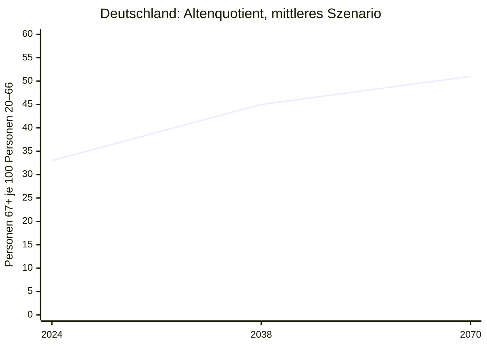
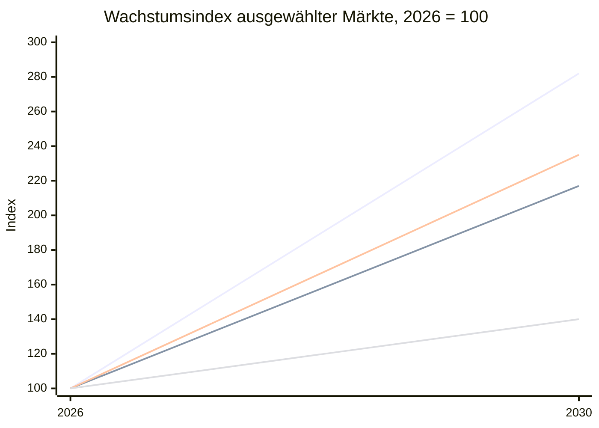
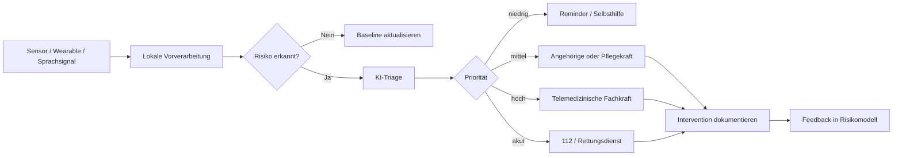
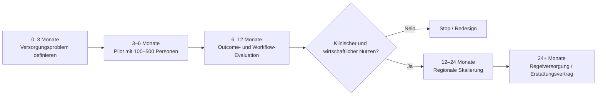

# Silver Society, Instant Care und KI-gestützte Altenpflege

## Executive Summary

Die Alterung der Bevölkerung ist für Gesundheit und Pflege weniger ein Mengenproblem als ein **Kapazitäts- und Koordinationsproblem**. Die Zahl älterer Menschen steigt, zugleich wächst der Anteil der Hochaltrigen, bei denen Pflegebedürftigkeit, Multimorbidität und akute Ereignisse deutlich wahrscheinlicher werden. Weltweit soll der Anteil der Menschen ab 65 Jahren bis 2050 auf rund 17 Prozent steigen; in der EU lag der Anteil der Über-65-Jährigen bereits 2024 bei 21,6 Prozent. Deutschland befindet sich noch weiter im Übergang: Die Bevölkerung ab 67 Jahren wächst von 17,0 Millionen im Jahr 2025 auf mindestens 20,5 Millionen gegen Ende der 2030er-Jahre, während die Zahl der Menschen ab 80 Jahren von derzeit etwa sechs Millionen auf 8,5 bis 9,8 Millionen im Jahr 2050 steigt. citeturn859021search2turn859021search5turn812665search6

Für Deutschland ist der entscheidende Engpass bereits sichtbar. 2025 bezogen rund 6,43 Millionen Menschen Leistungen der sozialen oder privaten Pflegeversicherung; rund 5,52 Millionen davon wurden ambulant versorgt. Destatis erwartet bei konstanten Pflegequoten rund 6,8 Millionen Pflegebedürftige im Jahr 2055, bei weiter steigenden Pflegequoten wären es etwa 7,6 Millionen. Gleichzeitig könnte der Bedarf an beruflich Pflegenden bis 2049 auf 2,15 Millionen steigen. Selbst im günstigeren Trendszenario fehlen dann rund 280.000 Kräfte; ohne Fortschreibung positiver Erwerbstrends wären es rund 690.000. citeturn812665search9turn812665search7turn693404search0

Daraus entsteht ein wachsender Markt für **Instant Care**, verstanden in diesem Bericht als Versorgung, bei der ein Bedarf automatisch oder auf Knopfdruck erkannt, bewertet und innerhalb von Minuten an Angehörige, Pflegepersonal, Telemedizin oder Rettungsdienste eskaliert werden kann. Diese Kategorie ist statistisch nicht standardisiert. Sie überschneidet sich insbesondere mit Personal Emergency Response Systems, Telecare, Remote Patient Monitoring, virtueller Versorgung und Ambient Assisted Living. Entsprechend sollten Marktgrößen nicht addiert werden, da die Kategorien erhebliche Überschneidungen aufweisen. Marktstudien schätzen für 2026 beispielsweise rund 9 Milliarden US-Dollar für Personal Emergency Response Systems, 31 bis 36 Milliarden US-Dollar für Remote Patient Monitoring, rund 104 Milliarden US-Dollar für Telehealth Services sowie rund 68 Milliarden US-Dollar für AI in Aging and Elderly Care. Die jeweiligen Prognosen implizieren bis 2030/31 überwiegend zweistellige jährliche Wachstumsraten. citeturn455330search4turn455330search1turn455330search2turn455330search0turn455330search3

Die wirtschaftlich interessanteste Entwicklung ist die Verschiebung von **reaktiver Alarmierung zu kontinuierlicher, prädiktiver Versorgung**. Klassische Hausnotrufe warten auf einen Knopfdruck. Neuere Systeme kombinieren Radar-, Kamera-, Bewegungs-, Vital- oder Wearable-Daten mit Aktivitätserkennung, Machine Learning und Sprachschnittstellen. Dadurch lassen sich Stürze ohne aktives Zutun erkennen, Abweichungen von Routinen identifizieren, Medikamenteneinnahme unterstützen und Veränderungen des Gesundheitszustands früher eskalieren. Produkte und Forschungsprojekte von CarePredict, SafelyYou, AssistMe, LINDERA, VmedD, Fraunhofer und DFKI zeigen diese Entwicklung deutlich. citeturn513872search0turn513872search3turn513872search6turn954998search48turn513872search12turn513872search9turn513872search10

Die klinische Evidenz ist vielversprechend, zugleich heterogen. In einer randomisierten Studie mit 534 älteren multimorbiden Personen reduzierte ein zwölfmonatiges telemedizinisches Monitoring ungeplante Hospitalisierungen von 48,7 auf 40,4 Prozent; das adjustierte relative Risiko betrug 0,72. Eine große kanadische Beobachtungsstudie fand bei Remote Monitoring 3,4 zusätzliche Tage zu Hause innerhalb von 100 Tagen sowie rund 1.636 CAD niedrigere Gesundheitskosten. Andere randomisierte Studien zeigen dagegen keinen Nutzen oder sogar ungünstigere Ergebnisse für bestimmte ältere Subgruppen. Technologie allein erzeugt deshalb keinen Versorgungseffekt. Entscheidend sind Population, Alarmqualität, Reaktionsprozess und organisatorische Einbettung. citeturn933661search3turn933661search4turn933661search0

Die zentrale strategische These lautet daher: **Der größte Wert entsteht nicht durch das Gerät, sondern durch die verkürzte Strecke zwischen Signal und sinnvoller Intervention.** Ein Sensor, der einen Sturz erkennt, schafft wenig Wert, wenn niemand reagiert. Ein Algorithmus, der eine beginnende Verschlechterung erkennt, ist wertvoll, wenn er Fehlalarme begrenzt, Verantwortlichkeiten eindeutig macht und eine Intervention auslöst, bevor Rettungsdienst oder Krankenhaus erforderlich werden. Das macht Workflow-Integration, Erstattung, Interoperabilität und Haftung mindestens ebenso wichtig wie Modellgenauigkeit.

Deutschland besitzt dafür eine ungewöhnlich interessante Ausgangslage. Telemonitoring bei Herzinsuffizienz ist bereits regulär GKV-finanziert; Hausnotrufsysteme sind als Pflegehilfsmittel verankert; DiPA bieten prinzipiell einen direkten Erstattungsweg in der häuslichen Pflege. Gleichzeitig zeigt das BfArM im Herbst 2026 für seine produktive DiPA-API weiterhin keine Daten, was auf die weiterhin geringe Marktdurchdringung des Pfads hinweist. Seit Juli 2026 wurde der DiPA-Rahmen deshalb erweitert, unter anderem auf Anwendungen für pflegende Angehörige und um eine vorläufige Aufnahme. citeturn348201search2turn348201search3turn703821search3turn544993search3turn161049search0turn161049search3

Für Politik, Pflegekassen und Betreiber ergibt sich daraus ein klarer Prioritätenwechsel: Finanzierung sollte sich stärker an **messbaren Versorgungsergebnissen** orientieren, beispielsweise Reaktionszeit, vermeidbare Krankenhauseinweisungen, Sturzfolgen, Zeitgewinn für Pflegekräfte, Medikamentenadhärenz oder zusätzliche Tage zu Hause. Technologien mit geringer klinischer Relevanz sollten nicht deshalb skaliert werden, weil sie technisch beeindruckend sind.

## Demografie, Pflegebedarf und die entstehende Versorgungslücke

Die Silver Society entsteht durch zwei gekoppelte Prozesse: Menschen leben länger und nachfolgende Kohorten sind relativ kleiner. Dadurch steigt sowohl die absolute Zahl älterer Menschen als auch ihr Verhältnis zur Bevölkerung im Erwerbsalter. Weltweit wird die Zahl älterer Menschen weiter erheblich zunehmen; die UN erwartet, dass bis 2050 ungefähr jeder sechste Mensch 65 Jahre oder älter sein wird. citeturn859021search2turn859021search4

In der EU stieg der Anteil der Menschen ab 65 Jahren zwischen 2004 und 2024 von 16,4 auf 21,6 Prozent. Der Anteil der Über-80-Jährigen erhöhte sich im gleichen Zeitraum von 3,8 auf 6,1 Prozent. Gleichzeitig stieg das Medianalter der EU-Bevölkerung auf 44,7 Jahre. citeturn859021search5

Der Altenquotient zeigt die ökonomische Konsequenz. In der EU kamen 2024 nach der Eurostat-Definition mit 20- bis 64-Jährigen bereits 37 Menschen ab 65 auf 100 Menschen im Erwerbsalter. 2004 waren es 26,8. citeturn859021search8

Deutschland durchläuft in den nächsten zwölf Jahren einen besonders steilen Abschnitt der Alterung. Nach der 16. koordinierten Bevölkerungsvorausberechnung steigt der Altenquotient, hier definiert als Bevölkerung ab 67 im Verhältnis zu 20- bis 66-Jährigen, von 33 im Jahr 2024 im moderaten Szenario auf rund 45 im Jahr 2038. Für 2070 ergeben die Szenarien Werte zwischen 43 und 61; das moderate Szenario liegt bei rund 51. citeturn859021search10

*Quelle und Definition: 16. koordinierte Bevölkerungsvorausberechnung, Destatis; die Grafik zeigt Variante 2 mit moderater Entwicklung. Vorausberechnungen sind Szenarien und keine Punktprognosen.* citeturn859021search10

Für den Pflegebedarf ist das Wachstum der Hochaltrigkeit wichtiger als die bloße Zahl der Über-65-Jährigen. Die deutsche Pflegekräftevorausberechnung verweist darauf, dass in der Altersgruppe 80 bis 84 bereits etwa 25 Prozent der Männer und 35 Prozent der Frauen pflegebedürftig sind; ab 90 Jahren steigen diese Werte auf rund 70 beziehungsweise 86 Prozent. citeturn693404search0

Deutschland überschritt 2025 erstmals die Marke von sechs Millionen Pflegeleistungsbeziehenden deutlich. Insgesamt waren es 6,43 Millionen, darunter 5,52 Millionen ambulant versorgte Personen und rund 771.000 stationär Versorgte. Die ambulante Versorgung wächst damit wesentlich stärker als die stationäre. citeturn812665search9

Diese Struktur macht Technologie besonders relevant. Viele der zusätzlichen Pflegebedürftigen werden nicht in Einrichtungen leben, sondern zu Hause, oft mit Angehörigen, ambulanten Diensten und punktuellen medizinischen Kontakten. Auch auf EU-Ebene erwartet der Joint Research Centre der Europäischen Kommission einen starken Anstieg der häuslichen Langzeitpflege. Im Basisszenario wächst der Anteil der Über-50-Jährigen mit häuslichem Langzeitpflegebedarf zwischen 2025 und 2075 von 19,4 auf 25,6 Prozent. Parallel werden Haushalte kleiner, sodass weniger informelle Pflege durch Partner oder Kinder verfügbar sein dürfte. citeturn459137search4turn459137search5

Der Pflegearbeitsmarkt kann diesen Nachfrageanstieg aus heutiger Sicht nicht allein durch zusätzliche Beschäftigung auffangen. 2025 waren rund 1,8 Millionen Pflegekräfte sozialversicherungspflichtig beschäftigt; examinierte Pflegeberufe gehören weiterhin zu den Engpassberufen, und die Arbeitslosenquote von Pflegefachkräften lag bei lediglich 1,1 Prozent. citeturn693404search3turn693404search5

Die Destatis-Modellierung verdeutlicht die Größenordnung:

| Kennzahl Deutschland | Ausgangswert | Projektion | Implikation |
|---|---:|---:|---|
| Pflegebedarf, berufliche Pflege | 1,62 Mio. Personen 2019 | 2,15 Mio. 2049 | +33 % citeturn693404search0 |
| Personalangebot, Trendszenario | 1,62 Mio. 2019 | 1,87 Mio. 2049 | rechnerische Lücke ca. 280.000 citeturn693404search0 |
| Personalangebot, Status quo | 1,62 Mio. 2019 | 1,46 Mio. 2049 | rechnerische Lücke ca. 690.000 citeturn693404search0 |
| Ambulante Dienste | Basis 2019 | +60 % Personalbedarf bis 2049 | stärkster relativer Mehrbedarf citeturn693404search0 |
| Pflege-/Alten-/Behindertenheime | Basis 2019 | +39 % Personalbedarf | rund 240.000 zusätzliche Kräfte citeturn693404search0 |

Die Versorgungslücke ist deshalb teilweise ein **Informationsproblem**. Heute werden viele Pflegeleistungen über feste Besuchsintervalle organisiert. Der tatsächliche Bedarf entsteht jedoch unregelmäßig. Ambient Monitoring und automatisierte Triage können diese Diskrepanz reduzieren: begrenzte personelle Kapazität wird stärker dort eingesetzt, wo gerade eine relevante Abweichung oder ein tatsächlicher Hilfebedarf vorliegt. Diese Produktivitätslogik dürfte zum zentralen wirtschaftlichen Treiber digitaler Altenpflege werden.

## Markt, Technologien und Use Cases

### Marktdefinition und Größenordnung

Der Begriff „Instant Care“ besitzt bislang keine einheitliche Marktdefinition. Für diese Analyse umfasst er vier überlappende Segmente: Personal Emergency Response Systems als unmittelbare Notfallreaktion, Telehealth als synchronen Fernzugang zu medizinischer Beratung, Remote Patient Monitoring als kontinuierliche Datenerfassung und KI-gestützte Eldercare-Systeme als prädiktive oder assistive Schicht über diesen Angeboten. Aufgrund unterschiedlicher Abgrenzungen können Marktstudien voneinander abweichen und dürfen nicht zu einem Gesamtmarkt addiert werden.

| Marktsegment | 2026 | Prognose | CAGR / Zeitraum | Einordnung |
|---|---:|---:|---:|---|
| Telehealth Services global | 103,5 Mrd. USD | 291,4 Mrd. USD 2030 | 30,2 % 2024–30 | virtuelle Versorgung, RPM und Echtzeitinteraktion citeturn455330search0 |
| Remote Healthcare global | 100,9 Mrd. USD | 219,0 Mrd. USD 2030 | 21,3 % 2025–30 | breiter als RPM, inkl. Tele-ICU und virtueller Versorgung citeturn455330search6 |
| Remote Patient Monitoring | 36,29 Mrd. USD | 66,33 Mrd. USD 2031 | 12,8 % 2026–31 | Software, Geräte und Monitoring citeturn455330search2 |
| PERS / Notrufsysteme | 8,97 Mrd. USD | 12,60 Mrd. USD 2030 | 8,8 % 2026–30 | Hausnotruf, mobile Notrufe, Sturzsensoren citeturn455330search4 |
| AI in Aging & Elderly Care | 67,56 Mrd. USD | 158,49 Mrd. USD 2030 | 23,8 % 2026–30 | breite Marktdefinition inklusive Robotik, IoT, Analytics und Assistenz citeturn455330search3 |
| RPM Software & Services Deutschland | 193,3 Mio. USD 2023 | 1,50 Mrd. USD 2030 | 33,9 % 2024–30 | kommerzielle Marktprognose citeturn455330search5 |

Die stark divergierenden Größen zeigen gleichzeitig die Unsicherheit solcher Marktprognosen. Anbieter kommerzieller Marktstudien verwenden eigene Segmentdefinitionen und extrapolieren oft aus relativ kleinen Datenbasen. Die Zahlen eignen sich daher besser zur Einschätzung von **Richtung und relativer Dynamik** als zur exakten Bewertung eines adressierbaren Marktes.

*Index aus den veröffentlichten 2026- und 2030-Marktwerten berechnet. Bei Telehealth, Remote Healthcare, AI Eldercare und PERS wurden die direkt veröffentlichten Endwerte verwendet; unterschiedliche Marktdefinitionen verhindern einen absoluten Vergleich der Segmentgrößen.* citeturn455330search0turn455330search6turn455330search3turn455330search4

### Technologie-Stack

Die wesentliche technologische Entwicklung liegt in der Kombination mehrerer Sensorkanäle mit einem Entscheidungssystem.

| Technologie | Erfasste Signale | Hauptnutzen | Kritische Grenze |
|---|---|---|---|
| Wearables | Bewegung, Puls, GPS, teils SpO₂/ECG | Mobilität, Sturz, Ortung, Vitalparameter | muss getragen und geladen werden |
| Ambient Radar / Bewegungssensoren | Präsenz, Gang, Lage, Bettbewegung | kontaktlos, dauerhaft, geringe Nutzungsinteraktion | Kontextinterpretation und Fehlalarme |
| Computer Vision | Haltung, Gang, Sturzereignis | hohe Kontextinformation | Privatsphäre und Akzeptanz |
| IoT / Smart Home | Türen, Herd, Bett, Aktivität | Routine- und Abweichungserkennung | Interoperabilität |
| NLP / Voice AI | Sprache und Gespräch | Dokumentation, Erinnerungen, Triage, Companion | Halluzinationen, Dialekte, kognitive Einschränkungen |
| Predictive Analytics | longitudinale Muster | frühe Erkennung von Verschlechterung | Datenqualität, Bias, erklärbare Schwellenwerte |
| Social Robotics | Sprache, Display, Bewegung | Aktivierung, Einsamkeit, Routinen | Kosten und begrenzte klinische Evidenz |

Diese Architektur ist bereits im Markt sichtbar. CarePredict kombiniert ein Wearable mit Aktivitätsanalyse und prädiktiven Warnungen; SafelyYou nutzt Ambient AI für Sturzerkennung; VmedD verwendet kontaktlose Sensoren zur Sturz- und Zustandsänderungserkennung; das DFKI-Projekt GUARDIAN kombiniert Sensorfusion, Human Activity Recognition und LLM-basierte Sprachinteraktion. citeturn513872search1turn513872search3turn513872search12turn513872search9

### Die wichtigsten Use Cases

**Sturzerkennung und Sturzprävention** sind der reifste Anwendungsfall. Wearables, Radar und Vision-Systeme können Stürze erkennen oder Fallrisiken aus Gangparametern ableiten. LINDERA analysiert beispielsweise Smartphone-Videos des Gangs zusammen mit Fragebogendaten, um individuelle Sturzrisikofaktoren zu identifizieren. citeturn954998search48turn954998search49

**Medikamentenmanagement** reicht von einfachen Erinnerungen bis zu elektronischen Dispensern und automatischer Eskalation bei ausgelassener Einnahme. Eine systematische Übersicht von 2025 fand Hinweise auf positive Effekte elektronischer Medikamentenspender, bezeichnete die Evidenz insgesamt jedoch als begrenzt; moderate Evidenz bestand unter anderem für Blutdruck- und HbA1c-Verbesserungen. citeturn933661search9

**Remote Monitoring und prädiktive Triage** verbinden Vitalparameter mit Algorithmen, die Schwellenwertverletzungen oder langfristige Muster erkennen. In Deutschland existiert mit dem Telemonitoring bei Herzinsuffizienz bereits ein regulierter GKV-Pfad, bei dem externe Geräte beziehungsweise Implantate täglich Daten übertragen und automatisierte Warnmeldungen erzeugen müssen. citeturn348201search3turn348201search5

**Soziale Begleitung** entwickelt sich durch generative KI schneller als die klinische Evidenz. ElliQ kombiniert Gespräch, Erinnerungen, Aktivierung und soziale Kommunikation. Ein randomisierter Versuch in Japan mit 73 alleinlebenden älteren Erwachsenen fand nach vier Wochen eine stärkere Reduktion der Einsamkeit in der Robotikgruppe; die Differenz gegenüber der Kontrollgruppe lag bei −3,1 Punkten auf der verwendeten Skala. citeturn513872search4turn933661search7

**Pflegeproduktivität** ist ein eigener Markt. Lösungen wie voize adressieren die Versorgung indirekt, indem sie Pflegedokumentation automatisieren. Das Unternehmen gibt eine wissenschaftlich untersuchte Zeitersparnis von 27 Prozent bei Dokumentationsaufgaben an; solche Tools können den Personalengpass wirtschaftlich teilweise relevanter beeinflussen als reine Consumer-Geräte. citeturn513872search7

## Evidenz: Was funktioniert und wo die Wirkung überschätzt wird

Die derzeitige Studienlage unterstützt vor allem drei Aussagen: Remote Monitoring kann bei gut selektierten Hochrisikopatienten Hospitalisierungen reduzieren; automatisierte Systeme können Adhärenz und Reaktionszeiten verbessern; und soziale Robotik kann psychosoziale Outcomes beeinflussen. Ein generalisierbarer Nachweis, dass KI-basierte Altenpflege insgesamt Kosten senkt oder Pflegepersonal ersetzt, existiert daraus noch nicht.

Eine multizentrische randomisierte Studie mit 534 älteren multimorbiden Personen im Durchschnittsalter von rund 80 Jahren untersuchte ein einjähriges sensorbasiertes Home-Monitoring. 40,4 Prozent der Interventionsgruppe wurden ungeplant wegen einer Dekompensation hospitalisiert, gegenüber 48,7 Prozent in der Kontrollgruppe. Das adjustierte relative Risiko betrug 0,72. citeturn933661search3

Eine kanadische Kohortenstudie mit 1.494 gematchten Paaren älterer Home-Care-Patienten fand für Remote Monitoring innerhalb von 100 Tagen 92,3 statt 88,9 Tage zu Hause. Die Gesundheitsausgaben lagen im Mittel um etwa 1.636 CAD niedriger. Da es sich um eine Beobachtungsstudie handelt, bleibt trotz Matching ein Restrisiko für Selektionsverzerrungen. citeturn933661search4

Die Evidenz ist jedoch keineswegs einseitig. Eine 2026 veröffentlichte randomisierte Studie mit 1.286 Personen nach Sepsis oder schwerer Atemwegsinfektion zeigte keinen Vorteil verschiedener Remote-Monitoring-Varianten bei den Tagen zu Hause. Bei Teilnehmern ab 65 Jahren schnitten mehrere Monitoring-Arme sogar schlechter als die Standardversorgung ab. citeturn933661search0

Diese Ergebnisse sind strategisch wichtig. **Mehr Monitoring kann mehr Intervention erzeugen, ohne bessere Outcomes zu erzeugen.** Ein System kann medizinisch harmlose Abweichungen sichtbar machen, zusätzliche Arztkontakte auslösen und Patientinnen verunsichern. Die richtige Zielgruppe und ein sinnvoller Alarmalgorithmus sind deshalb entscheidender als die maximale Sensordichte.

Bei Wearables zur Vorhersage von Stürzen fand eine Meta-Analyse von 20 Studien eine gepoolte Sensitivität von 55 Prozent, eine Spezifität von 89 Prozent und eine AUC von 0,85; Machine-Learning-basierte Ansätze erreichten in Subgruppen eine AUC von etwa 0,90. Die hohe Spezifität bei mäßiger Sensitivität spricht eher für Risikostratifizierung als für eine alleinige Sicherheitsgarantie. citeturn933661search6

Elektronische Medikamentenspender zeigten in einem kleinen randomisierten Pilotversuch eine durchschnittliche dokumentierte Adhärenz von 98,35 Prozent gegenüber 91,17 Prozent in der Kontrollgruppe. Die kleine Stichprobe von rund 50 Teilnehmenden begrenzt die Übertragbarkeit. citeturn933661search10

Auch Companion-Robotik liefert erste positive Ergebnisse. In dem japanischen RCT reduzierte ein sozialer Roboter Einsamkeit und verbesserte das psychologische Wohlbefinden. Ein kleiner Pilotversuch mit PARO bei hospitalisierten älteren Menschen mit Demenz berichtete zudem weniger psychotrope Medikamente und weniger Delir-Episoden als in der Vergleichsgruppe; die Stichprobe umfasste lediglich 38 vollständig analysierte Personen. citeturn933661search7turn933661search8

### Evidenzgrad nach Use Case

| Use Case | Evidenzlage | Erwartbarer KPI | Einschätzung |
|---|---|---|---|
| Telemonitoring chronischer Hochrisikopatienten | mehrere RCTs, heterogen | Hospitalisierung, Days at Home | **mittel bis gut**, stark populationsabhängig citeturn933661search3turn933661search0 |
| Sturzrisiko-Analytics | Meta-Analysen vorhanden | Sensitivität, Spezifität, Sturzrate | **mittel**; gute Risikostratifizierung citeturn933661search6 |
| Elektronische Medikamentendispenser | kleine RCTs + Reviews | Adhärenz, Blutdruck, HbA1c | **mittel**, klinische Endpunkte weniger robust citeturn933661search9turn933661search10 |
| Social Robotics / Companion AI | kleine RCTs | Einsamkeit, Wohlbefinden | **früh, positiv** citeturn933661search7turn933661search8 |
| Generative KI-Triage bei älteren Menschen | begrenzte spezifische Outcome-Daten | sichere Eskalation, Fehlalarme | **unzureichend für autonome klinische Entscheidungen** |
| Ambient Monitoring zu Hause | erste RCTs und Kohorten | Days at Home, institutionelle Aufnahme | **gemischt** citeturn933661search2turn933661search4 |

Der relevante Ziel-KPI für viele Lösungen sollte deshalb weniger „AI accuracy“ sein. Für Pflegekassen und Betreiber sind **vermeidete Krankenhausaufnahmen, vermiedene Rettungseinsätze, Reaktionszeit, Pflegeminuten, Sturzfolgen, Tage im eigenen Zuhause und Lebensqualität** ökonomisch aussagekräftiger.

## Anbieter, Geschäftsmodelle und Beschaffung

Der Markt lässt sich in vier Anbietergruppen gliedern: klassische Notrufanbieter, Remote-Monitoring-Plattformen, KI-gestützte Safety- und Analytics-Anbieter sowie Pflegeworkflow-Software.

### Vergleich ausgewählter Anbieter

| Anbieter | Herkunft / Segment | Kerntechnologie | Haupt-Use-Case | Preis / Modell |
|---|---|---|---|---|
| CarePredict | USA, Senior Living/Home Care | Wearable + AI-Aktivitätsanalyse | Gesundheitsverschlechterung, Sturz, Ortung | B2B, Preis öffentlich nicht transparent citeturn513872search0turn859462search25 |
| SafelyYou | USA, Senior Living | Ambient Computer Vision / AI | Sturzerkennung und Fallanalyse | B2B, Preis auf Anfrage citeturn513872search2turn513872search3 |
| ElliQ / Intuition Robotics | USA/Israel, Consumer/Payer | Conversational AI + Robotik | Einsamkeit, Aktivierung, Reminder | etwa 39–59 USD/Monat je Laufzeit; Device-Leasing enthalten citeturn859462search0turn859462search4 |
| LINDERA | Deutschland | KI-Ganganalyse per Smartphone | Sturzrisiko und Mobilität | B2B/Pflegekassen; Preis nicht öffentlich citeturn954998search48turn954998search7 |
| AssistMe | Deutschland | Sensorik + IoT | Inkontinenz- und Bewegungsmonitoring | B2B/Pflegeeinrichtungen citeturn513872search6 |
| voize | Deutschland | Speech-to-Text + NLP | Pflegedokumentation | SaaS B2B, Preis auf Anfrage citeturn513872search7 |
| VmedD | Deutschland | kontaktlose Sensorik | Sturz- und Zustandsmonitoring | Sensor ab öffentlich ausgewiesenen 239 €, Service 12,95 €/Monat citeturn859462search1turn859462search6 |
| Patronus | Deutschland | mobile Notrufuhr + Zentrale | 24/7-Instant Care | bei genehmigtem Pflegekassenzuschuss laut Anbieter ab ca. 2 €/Monat; Gerätekosten je Tarif citeturn954998search36turn954998search44 |
| libify | Deutschland | Haus-/Mobilnotruf + Sturzsensor | akute Alarmierung | Pflegekassenzuschuss möglich; je Tarif verbleiben laut Anbieter teils Mehrkosten citeturn954998search15turn954998search16 |
| easierLife | Deutschland | Hausnotruf + Aktivitätssensorik | Alarmierung und Familien-App | Hausnotruf kann bei Voraussetzungen über Pflegekasse finanziert werden citeturn954998search14turn954998search24 |

Die Tabelle zeigt zwei unterschiedliche Märkte. **Consumer Instant Care** wird überwiegend über Hardware plus monatlichen Service verkauft. **Institutional AI Care** funktioniert meist als B2B-SaaS-, Lizenz- oder Per-Bed-Modell und bindet Pflegeeinrichtungen, Versicherer oder Gesundheitsanbieter ein.

### Kosten- und Beschaffungslogik in Deutschland

Hausnotrufsysteme befinden sich bereits im Pflegehilfsmittelverzeichnis. Seit April 2026 gelten neue Verträge des GKV-Spitzenverbands; anspruchsberechtigte Versicherte sollen grundsätzlich mehrkostenfrei mit einem geeigneten System versorgt werden können, sofern Anbieter und Produkt die Voraussetzungen erfüllen. citeturn703821search1turn703821search3

Digitale Pflegeanwendungen stellen einen zweiten Pfad dar. Für gelistete DiPA besteht bei Pflegebedürftigen in der Häuslichkeit ein Erstattungsanspruch bis zu 40 Euro monatlich; zusätzlich können bis zu 30 Euro monatlich für notwendige ergänzende Unterstützungsleistungen durch ambulante Pflegedienste vorgesehen sein. Seit Juli 2026 umfasst die Definition auch Anwendungen, die pflegende Angehörige entlasten oder die häusliche Versorgung stabilisieren. citeturn544993search3

Das Problem liegt bisher weniger im Rechtsrahmen als im Marktzugang. Im März 2026 stellte das BMG fest, dass bislang keine DiPA im Verzeichnis gelistet war. Die produktive BfArM-DiPA-API meldete auch im Herbst 2026 weiterhin, dass derzeit keine Daten bereitgestellt werden. Die Reform von 2026 soll deshalb Antrags- und Prüfverfahren vereinfachen und eine vorläufige Aufnahme ermöglichen. citeturn544993search7turn161049search0turn161049search3

Telemedizin besitzt dagegen bereits einen etablierten GKV-Pfad. Telemonitoring für bestimmte Patientinnen und Patienten mit Herzinsuffizienz ist seit 2021 Bestandteil der vertragsärztlichen Versorgung. Telemedizinische Zentren erhalten über EBM-Positionen Vergütung für Monitoring und technische Infrastruktur; externe Messgeräte müssen unter anderem tägliche Datenübertragung und automatisierte patientenindividuelle Warnmeldungen ermöglichen. citeturn348201search2turn348201search3turn348201search7

Daraus ergeben sich vier typische Procurement-Routen:

1. **Direktkauf durch Haushalte oder Angehörige:** Notrufuhren, Sensorik, Companion AI und Smart-Home-Technik.
2. **Pflegeversicherung:** Hausnotruf, Pflegehilfsmittel und perspektivisch DiPA.
3. **Krankenversicherung / vertragsärztliche Versorgung:** indikationsgebundenes Telemonitoring und Medizinprodukte.
4. **B2B-Beschaffung:** Pflegeheime, ambulante Dienste, Wohnungsunternehmen und Betreiber kaufen Technologie anhand von Personalkosten, Sicherheits-KPIs und Risikoreduktion.

Das kommerziell attraktivste Modell dürfte mittelfristig häufig **B2B2C über Pflegekassen, Versicherer oder Senior-Living-Betreiber** sein. Die zahlende Partei profitiert hier selbst von vermiedenen Kosten, während ältere Menschen keine hohe Anschaffungsschwelle tragen.

### Idealer Instant-Care-Pfad

Die Architektur reduziert Kosten nur dann, wenn niedrigriskante Ereignisse auf niedriger Ebene gelöst werden und echte Hochrisikoereignisse schneller eskalieren. Ein schlecht kalibrierter Algorithmus erzeugt dagegen Alarmmüdigkeit, zusätzliche Arbeit und potenziell mehr medizinische Inanspruchnahme.

## Regulierung, Ethik und Adoptionsbarrieren

Gesundheitsdaten gehören nach Artikel 9 DSGVO zu den besonders geschützten Kategorien personenbezogener Daten. Systeme, die Vitalwerte, Bewegungsmuster, Medikamenteneinnahme oder Gesundheitszustände verarbeiten, benötigen deshalb eine belastbare Rechtsgrundlage und angemessene Schutzmaßnahmen. citeturn348201search0turn348201search1

Die EU-KI-Verordnung gilt grundsätzlich seit dem 2. August 2026. Für Hochrisiko-KI gelten abgestufte Übergangsfristen. KI-Systeme, die als Sicherheitskomponente eines Medizinprodukts beziehungsweise als Medizinprodukt einer entsprechenden Konformitätsbewertung unterliegen, können unter die Hochrisikoregeln fallen; relevante Anforderungen für produktbezogene Systeme gelten nach der aktuellen Stufung später vollständig. citeturn544993search0turn544993search1

Parallel wird der European Health Data Space die Anforderungen an Interoperabilität und Datenzugang verändern. Die Verordnung gilt grundsätzlich ab dem 26. März 2027; zentrale Pflichten für grenzüberschreitende Primärnutzung und Sekundärnutzung werden schrittweise ab 2029 und 2031 wirksam. citeturn544993search2turn544993search5

Für Anbieter entsteht damit ein mehrschichtiger Compliance-Stack:

| Ebene | Relevanz |
|---|---|
| DSGVO | Rechtsgrundlage, Datenminimierung, Sicherheit, Betroffenenrechte |
| MDR | falls die Software oder Hardware medizinische Zweckbestimmung besitzt |
| EU AI Act | Risikoklassifizierung, Risikomanagement, Dokumentation und Aufsicht |
| EHDS | künftige Interoperabilität und Gesundheitsdatenzugang |
| SGB V / XI | Erstattung und Zugang zu GKV bzw. Pflegeversicherung |
| Medizinische / pflegerische Haftung | Verantwortlichkeit für Alarmierung, Nichtalarmierung und Fehlentscheidung |

Die größte ethische Herausforderung ist **Überwachung im privaten Lebensraum**. Ein System, das rund um die Uhr Bewegung, Sprache oder Video analysiert, kann Sicherheit erhöhen und gleichzeitig die Autonomie der Person berühren. Privacy-by-Design, Edge-Verarbeitung und eine möglichst geringe Datentiefe sind deshalb echte Produktmerkmale. VmedD wirbt beispielsweise mit kontaktloser Sensorik, während das Forschungsprojekt GUARDIAN lokale beziehungsweise privacy-orientierte Sensorfusion untersucht; Velia verarbeitet die Sturzerkennung nach eigenen Angaben lokal auf einem Smartphone und speichert keine Videoaufnahmen in der Cloud. citeturn513872search12turn513872search9turn513872search11

Ein zweiter Konflikt betrifft **Autonomie und Fürsorge**. Bei kognitiven Einschränkungen ist Zustimmung komplex. Angehörige wünschen häufig stärkere Überwachung als die betroffene Person. Produktdesign sollte deshalb granular kontrollierbare Sichtbarkeit vorsehen: beispielsweise „alles normal“, „ungewöhnliche Inaktivität“, „akuter Alarm“, statt permanente Live-Beobachtung.

Eine dritte Grenze ist digitale Teilhabe. 2025 nutzten zwar 87 Prozent der 65- bis 74-Jährigen in Deutschland das Internet innerhalb der letzten drei Monate, zehn Prozent dieser Altersgruppe hatten das Internet jedoch noch nie genutzt. Für Menschen ab 80 liegen aktuellere amtliche Vollerhebungen kaum vor; die D80+-Studie ergab bereits 2022 lediglich 37 Prozent Internetnutzung. citeturn865225search0turn865225search2turn865225search4

Auch Nutzung ist nicht gleich Kompetenz. Eurostat zufolge besaßen 2025 nur rund 33 Prozent der 65- bis 74-Jährigen in der EU mindestens grundlegende digitale Fähigkeiten. citeturn865225search7

Daraus folgt ein wesentlicher Designgrundsatz: **Die nächste Generation der Altenpflege-Technologie sollte möglichst wenig App-Bedienung verlangen.** Sprachsteuerung, passive Sensorik, automatische Verbindung und physische Notfalloptionen sind für Hochaltrige oft skalierbarer als Smartphone-zentrierte Workflows.

Die reine Netzinfrastruktur ist in Deutschland zunehmend weniger das Hauptproblem. Mitte 2024 waren etwa 93,7 Prozent der Haushalte mit mindestens 100 Mbit/s erreichbar, rund 76,5 Prozent mit Gigabit; im Oktober 2025 waren ungefähr 98 Prozent der Fläche mit 4G oder 5G abgedeckt. Regionale Funklöcher und Gebäudesituationen bleiben relevant, doch Nutzungskompetenz, Installation und Support sind häufig größere praktische Hürden. citeturn865225search8turn865225search6

## Strategische Empfehlungen und Deployment-Roadmap

Die Silver Society verlangt keine maximal digitalisierte Pflege. Sie verlangt ein System, das knappe menschliche Pflegezeit **präziser verteilt**. Technologie sollte deshalb entlang ihrer Fähigkeit bewertet werden, menschliche Aufmerksamkeit im richtigen Moment verfügbar zu machen.

**Für Deutschland sollte die erste Priorität auf Use Cases mit klarer Ereignis- und Kostenlogik liegen.** Stürze, Dekompensation chronischer Erkrankungen, Medikamentenfehler, nächtliche Inaktivität und vermeidbare Rettungsdiensteinsätze eignen sich besser für Outcome-basierte Finanzierung als diffuse „Wellbeing“-Anwendungen. Die vorhandene Evidenz ist hier deutlich weiter entwickelt. citeturn933661search3turn933661search6turn933661search9

**Pflegekassen sollten stärker experimentelle, befristete Outcome-Verträge einsetzen.** Ein Anbieter könnte beispielsweise pro versorgter Person eine Grundgebühr erhalten und einen variablen Anteil bei definierten Ergebnissen: weniger sturzbedingte Klinikeinweisungen, geringere Rettungsdiensteinsätze, verbesserte Adhärenz oder zusätzliche Tage zu Hause. Dadurch verschiebt sich der Wettbewerb von Hardwarefeatures auf Versorgungsergebnisse.

**Der DiPA-Pfad sollte konsequent auf Implementierbarkeit geprüft werden.** Dass trotz rechtlicher Grundlage über Jahre kaum beziehungsweise keine Anwendungen in die Regelversorgung gelangt sind, deutet auf eine Lücke zwischen regulatorischer Intention und kommerzieller Realität. Die 2026 eingeführte vorläufige Aufnahme ist deshalb sinnvoll, sollte aber mit klaren Real-World-Evidence-Kriterien verbunden werden. citeturn544993search7turn161049search0turn161049search3

**Beschaffung sollte Workflow-Integration verpflichtend bewerten.** Mindestkriterien sollten API-/FHIR-Fähigkeit, Alarmrouting, dokumentierte Reaktionszeiten, Offline-Fallback, Geräteverwaltung, Rollen- und Rechtekonzept sowie Integration in bestehende Pflege- und Arztsoftware umfassen. Der kommende EHDS erhöht den strategischen Wert interoperabler Systeme zusätzlich. citeturn544993search2turn348201search5

**KI sollte bei kritischen Entscheidungen vorerst als Eskalations- und Priorisierungsschicht dienen.** Gerade bei Sturzrisiko, akuter Verschlechterung und Medikamentenfragen bleibt eine menschliche Verantwortungsinstanz wichtig. Die gemischte Evidenz zu Remote Monitoring zeigt, dass mehr Daten keinen linearen Nutzen erzeugen. citeturn933661search0turn933661search3

**Deutschland sollte Versorgungstechnologie zugleich als Produktivitätspolitik behandeln.** Bei einer möglichen Lücke von 280.000 bis 690.000 Pflegekräften bis 2049 reicht die reine Rekrutierungsstrategie rechnerisch kaum aus. Die Kombination aus zusätzlichem Personal, höherer Bindung, weniger Administration und technischer Priorisierung realer Pflegebedarfe besitzt einen wesentlich größeren Hebel. citeturn693404search0

### Empfohlener Deployment-Pfad

Für Pilotprojekte sollten mindestens fünf KPI-Gruppen parallel gemessen werden: **klinische Outcomes**, etwa Hospitalisierungen und Stürze; **operative Outcomes**, etwa Alarmzahl und Reaktionszeit; **Arbeitsproduktivität**, etwa Minuten pro Pflegekraft und Dokumentationszeit; **Nutzerakzeptanz**, etwa Abbruchquote und tägliche Nutzung; sowie **ökonomische Outcomes**, etwa Gesamtkosten pro versorgter Person.

Der wirtschaftliche Sweet Spot entsteht, wenn ein System drei Bedingungen gleichzeitig erfüllt: Der Zustand lässt sich digital zuverlässig beobachten, eine frühe Intervention verändert den Verlauf und der vermiedene Schaden ist größer als die laufenden Monitoring- und Response-Kosten. Herzinsuffizienz ist dafür ein gutes Beispiel, weshalb Telemonitoring hier bereits Erstattungsstatus erreicht hat. citeturn348201search2turn348201search3

Die größte Chance der nächsten zehn Jahre liegt deshalb wahrscheinlich weniger in einem universellen „AI caregiver“ als in einem **mehrschichtigen Care Operating System**: passive Sensorik erkennt relevante Veränderungen, KI priorisiert, Angehörige und Fachkräfte übernehmen die geeignete Intervention, Telemedizin löst einen Teil der Fälle aus der Distanz und der Rettungsdienst bleibt für echte Notfälle reserviert. Die Technologie gewinnt ihren Wert aus dieser Orchestrierung.

### Einordnung der Datenlücken

Mehrere Unsicherheiten bleiben wesentlich. Erstens existiert kein standardisierter Markt „Instant Care“, weshalb die verwendeten Marktsegmente überlappen. Zweitens stammen Marktgrößen überwiegend aus kommerziellen Research-Häusern und sollten als Szenarien behandelt werden. Drittens sind viele Wirksamkeitsstudien klein, indikationsspezifisch oder außerhalb Deutschlands durchgeführt worden. Viertens sind Kosten vieler B2B-Systeme nicht öffentlich und werden individuell nach Bettzahl, Einrichtung oder Serviceumfang verhandelt. Fünftens fehlen derzeit belastbare Langzeitdaten dazu, ob generative KI-Companions über mehrere Jahre Pflegebedarf, Krankenhausnutzung oder institutionelle Einweisungen reduzieren.

Trotz dieser Unsicherheiten ist die strukturelle Richtung sehr robust. Die Zahl Hochaltriger wächst, Pflegebedarf und Personalbedarf steigen, informelle Pflegekapazitäten werden relativ knapper und digitale Versorgung verlagert sich von einzelnen Notrufknöpfen zu kontinuierlicher Beobachtung, Priorisierung und Eskalation. citeturn812665search6turn459137search4turn693404search0

Damit wird „Instant Care“ weniger zu einer einzelnen Produktkategorie als zu einer **neuen Versorgungsschicht zwischen selbstständigem Leben und professioneller Pflege**. Gewinner werden voraussichtlich jene Anbieter und Gesundheitssysteme sein, die diese Schicht klinisch sinnvoll, regulatorisch belastbar und tief in vorhandene Versorgungsprozesse integrieren.